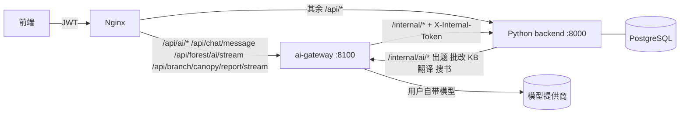

# Agent 逻辑与主流程拆解

> 源码核对日期：2026-11-27。本文对照当前代码描述前后端对话编排与多智能体主流程；接口字段详见 [业务接口](../api-specs/API-业务接口.md) 与 [后端技术文档](./backend-tech-stack.md)。设计背景见 [TS/Pi 重构设计](./ts-pi-agent-redesign.md)。

---

## 1. 架构总览

AI 编排由独立的 **TypeScript AI 网关**（`ai-gateway/`，Hono + `@langchain/langgraph`(JS) + Pi `Agent`）承担；Python 后端只保留**数据核心**：持久化、确定性契约校验（画像、路径、大纲、教材可见性、测验口径）和 `/internal/*` 数据接口。两者之间只通过带 `X-Internal-Token` 的内部接口通信，浏览器永远不会访问 `/internal/*`。



模型配置按**用户**保存（`UserModelProvider`、`UserCustomModel`、`UserModelPreferences`，凭据由 `MODEL_SECRET_ENCRYPTION_KEY` 加密），网关每次请求按“场景”解析模型；未配置模型时返回 `MODEL_NOT_CONFIGURED`，前端据此拦截并跳转配置页，不会回退到任何全局密钥。

场景（`Scene`）：`chat_profile`、`path_outline`、`course_resources`、`quiz_vision`（唯一视觉场景）、`growth_report`、`kb_translate`、`kb_search`。

---

## 2. 前端对话与页面入口链路

### 2.1 应用外壳与路由门禁

入口位于 [App.tsx](../../frontend/src/App.tsx)：

- `AuthProvider`（[AuthContext.tsx](../../frontend/src/contexts/AuthContext.tsx)）提供登录态 `token` 与 `user`。
- `AiWidgetProvider`（[AiWidgetContext.tsx](../../frontend/src/contexts/AiWidgetContext.tsx)）管理全局 AI 面板状态（`HIDDEN` / `CENTER_INPUT` / `PROCESSING` / `EXPANDED` / `WIDGET`）与待发送消息队列（`pendingMessage`）。
- `AnimatedRoutes` 划分公共入口（`/login`）、管理端路由（`/admin/*`）与学生端五阶段工作区（`/sprout`、`/branch`、`/leaf`、`/leaf/:courseNodeId`、`/forest`、`/forest/:courseNodeId`、`/canopy`）。
- `GlobalAiWidget` 在 `/login`、`/forest`、`/forest/*`、`/admin/*` 下隐藏；其余页面挂载悬浮 AI 面板。

### 2.2 学生首页与全局 AI 面板协作

- **首页主入口**（[SproutHero.tsx](../../frontend/src/components/home/SproutHero.tsx)）：
  - 拉取 `GET /api/profile/dashboard`。
  - 已有未完成的当前课程时，主行动聚焦“继续今天的学习”，点击直接跳转 `/leaf/:courseNodeId`。
  - 未完善画像时，主行动提供“完善学习画像”，点击调用 `setWidgetState("EXPANDED")` 打开 AI 对话面板；已完善画像但暂无当前课程时，引导进入 `/branch`。
- **全局面板状态机**（[GlobalAiWidget.tsx](../../frontend/src/components/onboarding/GlobalAiWidget.tsx)）：
  - 未登录（`!token`）：清空 `pendingMessage` 并强制收起为 `HIDDEN`。
  - 处于 `HIDDEN` 且已登录时：若当前路径为 `/sprout` 且 URL 带有非空 `session_id`，自动展开为 `EXPANDED` 恢复既有会话；否则切换为右下角悬浮按钮态 `WIDGET`。
  - 面板内容由 [AiGreetingInput.tsx](../../frontend/src/components/onboarding/AiGreetingInput.tsx) 驱动，配合 `useChatSession`、`chatReducer`、`streamSession()` 与 `fetchSessionState()` 完成 SSE 事件归并、结构化卡片渲染和本地会话缓存。

---

## 3. 对话入口与 Python 侧职责

- `POST /api/chat/start`、`GET /api/chat/sessions/{session_id}`：仍由 Python（[orchestration.py](../../backend/app/api/orchestration.py)）提供，创建会话并返回消息历史、画像、按年路径和当前课程大纲状态。
- `POST /api/chat/message`：**由 AI 网关提供**（[chat/routes.ts](../../ai-gateway/src/chat/routes.ts)），同样校验 JWT 与会话归属后返回 SSE。Python 不再有该路由。
- 对话上下文与持久化通过 `/internal/chat/sessions/*`（[chat_context_service.py](../../backend/app/services/chat_context_service.py)）：`context` 返回历史、画像、路径、大纲与 `session_state`；`turn` 以“先整轮、失败回退只存用户消息”的方式追加消息。

---

## 4. 网关对话图与 Agent

对话图位于 [chat/graph.ts](../../ai-gateway/src/chat/graph.ts)（`StateGraph`，无 checkpoint，每轮从数据库重建上下文）：

```
START -> entry -> supervisor ─┬─> profile_agent ──────────┐
                  │           ├─> intake_agent -> learning_path_agent
                  │           ├─> outline_agent           ├─> finalize -> END
                  │           └─> resource_agent ─────────┘
                  └─ entry 也可直达 resource_agent（按钮协议 / 待确认的重新生成）
```

| 节点 | 模块 | 核心职责 | 主要工具 |
|---|---|---|---|
| `entry` | `chat/graph.ts` | 入口：发出 `session_started` 与上下文装载事件；资源生成按钮协议/待确认的重新生成回答直达 `resource_agent`（不靠关键词猜测）；模型未配置时在此拦截，不写任何数据 | — |
| `supervisor` | `chat/supervisor.ts` | 三阶段工具门禁（画像未完善只能走画像；无路径不能生成大纲等），防止越阶段调用 | `delegate_course_knowledge`、`delegate_course_resources` |
| `profile_agent` | `chat/profileAgent.ts` + `profileContract.ts` | 对话采集画像、问题卡片、自纠、保存 | `ask_profile_question`、`save_student_profile` |
| `intake_agent` | `chat/intakeAgent.ts` + `intakeContract.ts` | 课程草案：问答、风险确认、知识缺口保留 | `propose_or_revise_draft`、`confirm_draft`、`cancel_risk_revision` |
| `learning_path_agent` | `chat/pathAgent.ts` | 基于已确认草案生成按年路径，装配由 Python 完成 | `submit_learning_path_plan` |
| `outline_agent` | `chat/outlineAgent.ts` | 课程大纲命名（模型只命名，骨架/拆节/合规/带指纹原子保存由 Python 完成），支持全年并发 | `submit_outline_naming` |
| `resource_agent` | `chat/resourceAgent.ts` | 小节多模态资源：markdown → 视频/动画并行 → compose；检查点续跑、视频逐小节降级、重新生成需侧重点、章节锁 | `submit_section_markdown`、`submit_section_animations` |

工具调用统一经 [agentRunner.ts](../../ai-gateway/src/chat/agentRunner.ts) 运行 Pi `Agent`，工具失败会把可读原因回喂模型自纠，超过上限后以“可重试”错误收口。

确定性逻辑留在 Python，通过 `/internal/students/{uid}/...` 暴露：画像校验、路径装配、大纲 `outline-source-context`、`course-outlines/compose|batch`、章节 `generation-prepare/finish`、小节 `markdown/prompt|validate`、`video/search`、`animation/prompt|validate`、`resources`（按阶段合并保存）。

---

## 5. SSE 事件协议与持久化边界

[sse.ts](../../ai-gateway/src/sse.ts) 沿用旧契约：

1. 会话与初始化：`session_started`、`agent_calling`、`supervisor_thinking`、`data_update`。
2. 调度与执行：`supervisor_plan`、`text_chunk`、`agent_progress`、`agent_result`。
3. 异常与收口：`error`（含 `recoverable` / `retryable` / `retryAction` / `error_code`）、`message_completed`、`session_completed`（`session_id`、`has_profile`、`has_paths`、`has_outline`）。
4. 持久化顺序：轮次结束先通过 `/internal/chat/sessions/{id}/turn` 落库，再发最终完成事件；中途失败时至少保存用户消息，且不会写入空的 AI 消息。客户端断开不会取消已开始的章节生成（章节锁保证同一章不会并发）。
5. 心跳：每 15 秒发送 `: keep-alive` 注释帧，Nginx 对 SSE 路由关闭缓冲并将读超时设为 300 秒。

---

## 6. 其他 AI 能力（同样在网关）

- **测验出题与批改**（[ai/quiz.ts](../../ai-gateway/src/ai/quiz.ts)）：Python 的 `forest.py` 通过 `/internal/ai/quiz/generate|grade` 调用。出题用 `submit_quiz` 工具并允许一次自纠，失败返回明确错误（**没有兜底假题**）；单选题按规则判分，代码题用 `course_resources` 场景，图片题用 `quiz_vision` 视觉场景；总分 > 70 视为通过。支持断流恢复与幂等提交快照。
- **Forest AI 答疑**（`POST /api/forest/ai/stream`，[ai/forestAi.ts](../../ai-gateway/src/ai/forestAi.ts)）：提交前走苏格拉底式引导，提交后给完整解析；是否已提交由服务端判断，不信任前端；通过 `read_chapter_learning_material` 读取本章材料。
- **成森累计成长报告**（`POST /api/branch/canopy/report/stream`，[ai/growthReport.ts](../../ai-gateway/src/ai/growthReport.ts)）：证据工具 `read_quiz`、`read_chapter`、`read_textbook`（每次报告最多 6 次读取），提交工具 `submit_growth_report` 由 Python `report-validate` 做数字/引用溯源校验，最多自纠 2 次，保证不出现无法溯源的结论。
- **知识库 AI**：管理员的教材搜书与外文教材入库翻译使用**管理员本人**的模型配置（`KnowledgeBaseIngestionJob.triggered_by_uid` 记录触发者），经 `/internal/ai/kb/search-textbook-sources` 与 `/internal/ai/kb/translate-chunk` 调用网关（[ai/kb.ts](../../ai-gateway/src/ai/kb.ts)）。
- **教材知识库后台整理**（[knowledge_base_worker.py](../../backend/app/workers/knowledge_base_worker.py)）：仍由独立进程 `python -m app.workers` 运行，通过 PostgreSQL 行锁（`FOR UPDATE SKIP LOCKED`）、租约与心跳机制消费 `KnowledgeBaseIngestionJob`。

## 7. Python 侧遗留的确定性模块

`backend/app/orchestration/` 已不再包含任何 LangGraph/LangChain 代码，仅保留被内部接口复用的纯数据/契约工具：`contracts.py`、`grade_contract.py`（画像完整性与年级映射）、`prompt_budget.py`、`recovery.py`、`agents/course_knowledge.py`（大纲骨架与教材绑定 helper）、`agents/course_resources/*`（小节校验、Bilibili 搜索/校验、动画 HTML 校验与确定性兜底）、`agents/quiz.py`（题目规范化与及格线）。视频检索仍使用阿里云 DashScope 的 Bilibili 搜索，因此保留 `dashscope` 依赖与可选的平台 `LLM_API_KEY` / `LLM_MODEL`；未配置时视频按小节平稳降级为“暂无视频”。

---
