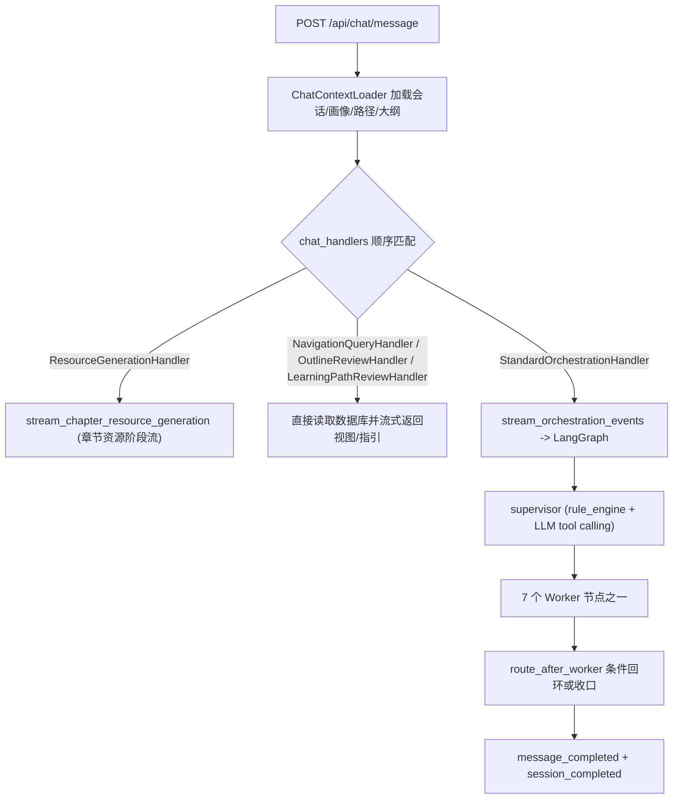

# Agent 逻辑与主流程拆解

> 源码核对日期：2026-11-26。本文对照当前代码描述前后端对话编排与多智能体主流程；接口字段详见 [业务接口](../api-specs/API-业务接口.md) 与 [后端技术文档](./backend-tech-stack.md)。

---

## 1. 架构总览

OneTree 的对话式个性化学习编排采用**无 checkpoint 的单轮 LangGraph `StateGraph`** 架构：每轮请求从 PostgreSQL 加载会话消息、学生画像、按年学习路径与当前课程大纲，构建 `OrchestrationState` 后运行单轮图执行，并通过 SSE 向前端流式输出过程事件与结果。

---

## 2. 前端对话与页面入口链路

### 2.1 应用外壳与路由门禁

入口位于 [App.tsx](../../frontend/src/App.tsx)：

- `AuthProvider`（[AuthContext.tsx](../../frontend/src/contexts/AuthContext.tsx)）提供登录态 `token` 与 `user`。
- `AiWidgetProvider`（[AiWidgetContext.tsx](../../frontend/src/contexts/AiWidgetContext.tsx)）管理全局 AI 面板状态（`HIDDEN` / `CENTER_INPUT` / `PROCESSING` / `EXPANDED` / `WIDGET`）与待发送消息队列（`pendingMessage`）。
- `AnimatedRoutes` 划分公共入口（`/login`）、管理端路由（`/admin/*`）与学生端五阶段工作区（`/sprout`、`/branch`、`/leaf`、`/leaf/:courseNodeId`、`/forest`、`/forest/:courseNodeId`、`/canopy`）。
- `GlobalAiWidget` 在 `/login`、`/forest`、`/forest/*`、`/admin/*` 下隐藏；其余页面挂载悬浮 AI 面板。

### 2.2 学生首页与全局 AI 面板协作

- **首页主入口**（[SproutHero.tsx](../../frontend/src/components/home/SproutHero.tsx)）：
  - 拉取 `GET /api/profile/dashboard`。
  - 已有未完成的当前课程时，主行动聚焦“继续今天的学习”，点击直接跳转 `/leaf/:courseNodeId`。
  - 未完善画像时，主行动提供“完善学习画像”，点击调用 `setWidgetState("EXPANDED")` 打开 AI 对话面板；已完善画像但暂无当前课程时，引导进入 `/branch`。
- **全局面板状态机**（[GlobalAiWidget.tsx](../../frontend/src/components/onboarding/GlobalAiWidget.tsx)）：
  - 未登录（`!token`）：清空 `pendingMessage` 并强制收起为 `HIDDEN`。
  - 处于 `HIDDEN` 且已登录时：若当前路径为 `/sprout` 且 URL 带有非空 `session_id`，自动展开为 `EXPANDED` 恢复既有会话；否则切换为右下角悬浮按钮态 `WIDGET`。
  - 面板内容由 [AiGreetingInput.tsx](../../frontend/src/components/onboarding/AiGreetingInput.tsx) 驱动，配合 `useChatSession`、`chatReducer`、`streamSession()` 与 `fetchSessionState()` 完成 SSE 事件归并、结构化卡片渲染和本地会话缓存。

---

## 3. 后端请求分派与处理器链

对话相关 HTTP 路由定义在 [orchestration.py](../../backend/app/api/orchestration.py)：

- `POST /api/chat/start`：创建并持久化新的 `ConversationSession`，返回 `session_id`。
- `POST /api/chat/message`：校验会话归属后返回 SSE `StreamingResponse`；`_stream_chat_events` 仅在推进异步生成器期间绑定请求 `engine` 上下文并在返回前清理。
- `GET /api/chat/sessions/{session_id}`：返回持久化消息历史及最新画像、按年路径与当前课程大纲状态。

`_stream_chat_events_impl` 在加载上下文后按优先级顺序匹配 [chat_handlers.py](../../backend/app/api/chat_handlers.py) 中的 5 类处理器：

1. `ResourceGenerationHandler`：处理课程章节教学资源生成请求。
2. `NavigationQueryHandler`：处理学习阶段与当前任务导航查询。
3. `OutlineReviewHandler`：命中已有课程大纲回顾/查看请求时直接读取数据库返回。
4. `LearningPathReviewHandler`：命中已有学习路径回顾请求时直接读取数据库返回。
5. `StandardOrchestrationHandler`：兜底进入 `stream_orchestration_events(state)` 执行 LangGraph 编排。

---

## 4. LangGraph 单轮编排与 7 个 Worker

编排图构建与流式执行位于 [graph.py](../../backend/app/orchestration/graph.py)，`WORKER_AGENTS` 包含以下 **7 个专职 Worker**：

| Worker 标识符 | 模块路径 | 核心职责 |
|---|---|---|
| `profile_agent` | `agents/profile.py` | 对话引导、信息采集与 `userprofile` 持久化 |
| `learning_path_intake_agent` | `agents/learning_path_intake.py` | 收集学习路径需求与课程草案，检索已发布教材并记录知识缺口 |
| `learning_path_agent` | `agents/learning_path.py` | 基于确认草案生成或刷新 `useryearlearningpath` 按年学习路径 |
| `course_knowledge_agent` | `agents/course_knowledge.py` | 生成或补全 `usercourseknowledgeoutline` 课程章节大纲 |
| `section_markdown_agent` | `agents/course_resources/markdown.py` | 生成小节图文讲解与视频/动画需求 brief |
| `section_video_search_agent` | `agents/course_resources/video.py` | 检索并校验 Bilibili/外部教学视频资源 |
| `section_html_animation_agent` | `agents/course_resources/animation.py` | 生成并校验交互式 HTML 教学动画 |

### 4.1 路由与规则守卫

- **入口**：`__start__ -> supervisor`（`agents/supervisor.py`）。`supervisor` 先执行 `rule_engine.py` 进行前置守卫与 `force_call` 拦截（如未完善画像禁止生成路径/大纲、无按年路径禁止生成课程大纲、显式开始课程或已完成态 follow-up 分流等），未命中强规则时才调用模型工具选择。
- **`route_after_supervisor`**：检查 `AIMessage.tool_calls[0].name`，若属于 `WORKER_AGENTS` 中的 7 个节点之一则进入对应 Worker，否则直接结束 `END`。
- **`route_after_worker`**：决定 Worker 执行后的流转：
  1. 若刚执行 `course_knowledge_agent` 且用户请求属于课程资源生成，同时 `course_knowledge` 已就绪，则回流 `supervisor` 衔接资源阶段。
  2. 若存在未完成的 `course_resource_plan`（且尚无 `course_resource_result`）：`target_section_ids` 就绪且缺少 `video_section_ids` 时进入 `section_video_search_agent`；已有 `video_section_ids` 且缺少 `animation_section_ids` 时进入 `section_html_animation_agent`。
  3. 若已有 `course_resource_result`，结束 `END`。
  4. 若刚执行 `learning_path_intake_agent` 且草案状态为 `confirmed`，回流 `supervisor` 触发路径生成。
  5. 若命中 `should_auto_continue_learning_path_after_profile(state)`（例如画像更新后需要自动刷新路径），回流 `supervisor`。
  6. 其余情况结束 `END`。
- **资源确定性拼装**：小节资源生成编排入口位于 [course_resources/main.py](../../backend/app/orchestration/agents/course_resources/main.py)，按 `markdown` → `video` → `animation` → `compose` 推进；其中 `compose` 是确定性拼装与质量契约校验阶段，不是 LangGraph 节点。

---

## 5. SSE 事件协议与持久化边界

`stream_orchestration_events` 对前端输出如下核心事件：

1. 会话与初始化阶段：`session_started`、`agent_calling`（含 `intent-routing` 阶段提示）、`supervisor_thinking`、`data_update`（`profile_loaded` / `paths_loaded`）。
2. 调度与执行阶段：`supervisor_plan`、`agent_calling`、`text_chunk`、`agent_progress`、`agent_result`（含 `success` 与失败信息）。
3. 异常与收口阶段：`error`（含 `recoverable` / `retryable` / `retryAction`）、`message_completed`（汇总最终文本）、`session_completed`（返回 `session_id`、`has_profile`、`has_paths`、`has_outline`）。
4. 持久化顺序：在短事务内将本轮用户与助手消息追加写入 `ConversationSession` 后，再发出最终完成事件，避免刷新恢复时丢失状态。

---

## 6. 独立于主编排图的智能体与后台任务

以下能力复用模型或任务队列运行，**不计入上述 7-Worker LangGraph 主图**：

- **测验生成、批改与 Forest AI 答疑**（[quiz.py](../../backend/app/orchestration/agents/quiz.py)）：由 `/api/forest/*` 路由和 `forest_service.py` / `forest_submission_service.py` 调用，支持断流恢复与幂等提交快照。
- **成森累计成长报告**（[growth_report_service.py](../../backend/app/services/growth_report_service.py)）：由 `POST /api/branch/canopy/report/stream` 触发，复用 Worker 模型并通过只读证据工具（`read_quiz`、`read_chapter`、`read_textbook`）和事实校验生成结构化报告。
- **教材知识库后台整理**（[knowledge_base_worker.py](../../backend/app/workers/knowledge_base_worker.py)）：由独立进程 `python -m app.workers` 运行，通过 PostgreSQL 行锁（`FOR UPDATE SKIP LOCKED`）、租约与心跳机制消费 `KnowledgeBaseIngestionJob`。
