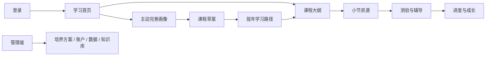

# OneTree 项目现状

> 源码核对日期：2026-11-27。本文用于新成员快速建立仓库地图；具体字段和行为以代码、测试和生成的 OpenAPI 为准。

## 产品闭环

OneTree 面向学生提供个性化学习路径：用户登录后进入学习首页，可继续当前课程或主动完善画像；系统生成课程草案和按年学习路径；进入课程后生成小节文档、视频和 HTML 动画资源；Forest 页面负责章节测验、批改、薄弱点和 AI 辅导；Canopy 展示成长结果。管理端负责培养方案、账户、学习数据和知识库。



## 代码地图

| 目录 | 责任 | 主要入口 |
|---|---|---|
| `frontend/src/App.tsx` | 路由、角色门禁、页面宿主 | `/login`、学生端和管理端路由 |
| `frontend/src/api/` | 前端 API 客户端 | 认证、路径、课程、测验、知识库等模块 |
| `backend/app/main.py` | FastAPI 应用装配 | 路由、CORS、请求 ID、数据库初始化 |
| `backend/app/api/` | HTTP 路由与 `/internal/*` 内部接口 | 按认证、路径、课程、Forest、管理端、模型配置拆分；`internal.py` 供网关调用 |
| `backend/app/services/` | 业务服务和持久化协调 | 知识库、画像、路径、课程、测验 |
| `ai-gateway/` | TypeScript AI 网关（Hono + LangGraph.js + Pi） | 对话图、各 Agent、出题批改、Forest AI、成长报告、知识库 AI、个人模型配置与用量 |
| `backend/app/orchestration/` | 纯契约/校验工具（无模型调用） | 画像完整性、大纲骨架与教材绑定、小节资源校验、Bilibili 搜索与校验 |
| `backend/app/workers/` | 独立后台任务 | 教材知识库整理任务 |
| `backend/app/models.py` | SQLModel 数据模型 | PostgreSQL 18 生产与独立隔离 schema 测试 |
| `deploy/` | 生产运行面 | Docker Compose、Nginx、迁移、备份、证书、smoke |

## Agent 编排

AI 编排由 `ai-gateway/` 承担，Python 后端是数据核心（详见 [Agent 逻辑](backend/agent逻辑.md)）。对话图节点为：`entry`、`supervisor`、`profile_agent`、`intake_agent`、`learning_path_agent`、`outline_agent`、`resource_agent`、`finalize`。

课程资源链路由 `resource_agent` 驱动，按 `markdown`、`video`/`animation`（并行）、`compose` 阶段按小节生成并写入检查点，支持续跑；视频逐小节平稳降级，重新生成需显式侧重点，同一章同时只允许一次生成。视频阶段包含 URL/来源校验；动画阶段包含 HTML 结构校验；资源结果通过质量契约后才进入组合结果。SSE 事件由 `ai-gateway/src/chat/routes.ts` 暴露，Nginx 将 `/api/chat/message` 等路由转发到网关。

模型由**用户个人配置**（`/api/model-config`），按场景绑定，未配置时对话与 AI 功能被拦截并引导配置；用量写入 `user_model_usage_log` 并在看板展示。

知识库整理不在上述对话图内。它由 `python -m app.workers` 消费 `KnowledgeBaseIngestionJob`，使用租约、心跳和重试处理长任务；其中的 AI 搜书与外文翻译使用触发整理的管理员的个人模型。

## 页面与接口入口

成森页支持手动生成累计 AI 成长报告：后端汇总真实学习记录，模型按需读取只读证据并生成结构化总结，页面支持来源展开、课程跳转和重新生成。该流程由 AI 网关运行（`POST /api/branch/canopy/report/stream`），不新增报告数据表。接口与统计口径见 [成长报告接口](api-specs/API-成长报告.md)。

学生端页面路由定义在 `frontend/src/App.tsx`：`/sprout`、`/branch`、`/leaf`、`/leaf/:courseNodeId`、`/forest`、`/forest/:courseNodeId`、`/canopy`。管理端路由包括 `/admin/programs`、`/admin/accounts`、`/admin/data` 和 `/admin/knowledge-base`。

后端路由由 `backend/app/main.py` 装配，按 `auth`、`orchestration`（仅 `/api/chat/start` 与会话状态）、`model_config`、`internal`（仅容器内网）、`profile`、`learning_path`、`branch`（含成长报告流式接口）、`leaf`、`forest`、`student`、`admin`（含 `/api/admin/program*` 培养方案维护端点）、`admin_data`、`knowledge_base` 和 `health` 分组。字段示例以 `docs/api-specs/` 与 `frontend/openapi.json` 为准。

## 本地开发与验证

后端需要 PostgreSQL 与 `uv`；AI 网关与前端需要 Node.js 22+ 和 npm。模型由用户在应用内配置，无需全局 LLM 密钥（仅视频检索可选使用平台 `LLM_API_KEY`）。

```bash
cd backend
uv run uvicorn app.main:app --reload --port 8000

cd ai-gateway
npm install && npm run dev   # 127.0.0.1:8100，Vite 开发代理已转发 /api/ai、/api/chat/message 等

cd frontend
npm install
npm run dev
```

常用验证：

```bash
cd backend && uv run pytest -q && uv run ruff check app tests
cd ai-gateway && npm run typecheck && npm run lint && npm test
cd frontend && npm test && npm run build
cd frontend && npm run e2e
```

生产部署只使用 `deploy/bin/bootstrap`、`deploy/bin/deploy` 等脚本，完整流程见 [`docs/deployment/docker-production.md`](deployment/docker-production.md)。

## 文档维护

- 修改 API schema 后在 `frontend/` 运行 `npm run gen:api`，并检查 `frontend/openapi.json` 与 `frontend/src/types/api.ts`。
- 修改网关对话图、工具、事件或资源契约时同步更新 [`docs/backend/backend-tech-stack.md`](backend/backend-tech-stack.md) 和 [`docs/backend/agent逻辑.md`](backend/agent逻辑.md)。
- 修改数据库模型或迁移时同步更新 [`docs/database/数据库表结构.md`](database/数据库表结构.md)。


## 学生登录后的关键流程

登录后进入 `/sprout` 学习首页，以当前课程的“继续学习”为主任务。五阶段名称保留，对应学习首页、学习路径、课程学习、章节测验、学习成长。`/leaf` 为课程目录，`/forest` 为课程和章节测验入口；阅读页按用户与课程保存本机阅读位置，优先采用有效的 URL `section_id`。画像由学生点击完善，详情可从个人菜单打开。

测验草稿使用本机 IndexedDB，按用户、课程、章节、测验、题目版本隔离，覆盖选择、代码和图片答案。提交快照与 UUID 支持断流后的结果确认；刷新不自动重新发送。详细交互约定见 [学生关键流程](ui-design/11-学生关键流程.md)。
